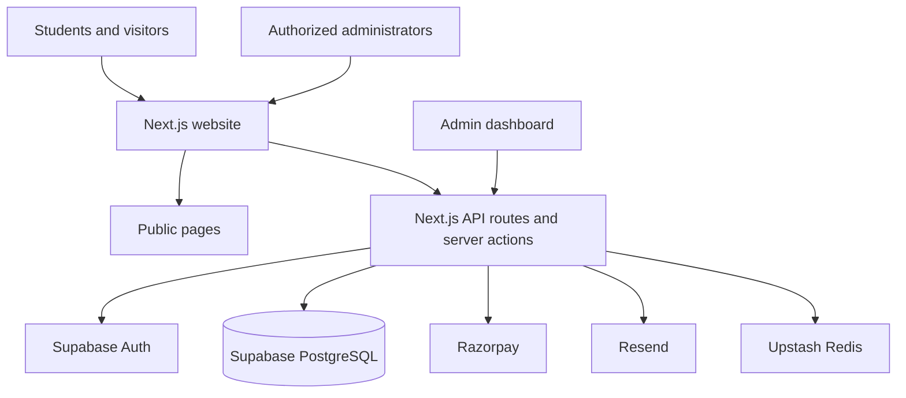

# Microsoft Student Community | SRM University-AP

<p align="center">
  
</p>

<p align="center">
  The digital home of Microsoft Student Community at SRM University-AP.
  Explore student activities, find events, register for experiences, and build with the community.
</p>

<p align="center">
  <a href="https://mscsrmap.xyz">Website</a> ·
  <a href="https://github.com/YUVRAJ-SINGH-3178/MSC-v2">Repository</a> ·
  <a href="https://www.linkedin.com/company/msc-srmap/">LinkedIn</a> ·
  <a href="https://www.instagram.com/msc_srmap/">Instagram</a>
</p>

---

## Welcome to MSC

Microsoft Student Community (MSC) at SRM University-AP is a student-led technology community focused on learning, building, and sharing. The MSC website brings the community's public activities and its event operations into one platform.

Whether you are a student looking to participate, a visitor learning about the community, or a developer interested in contributing, this guide will help you find the right starting point.

## Choose your path

| I am a... | Start here |
| --- | --- |
| **Student** | Explore [events](https://mscsrmap.xyz/events), [workshops](https://mscsrmap.xyz/workshops), and [hackathons](https://mscsrmap.xyz/hackathons). Learn about the community and take part in upcoming activities. |
| **Visitor** | Visit the [MSC website](https://mscsrmap.xyz), read [About MSC](https://mscsrmap.xyz/about), and follow the community on [LinkedIn](https://www.linkedin.com/company/msc-srmap/) and [Instagram](https://www.instagram.com/msc_srmap/). |
| **Developer** | Continue to [Local development](#local-development), [Configuration](#environment-variables), [Database](#supabase-and-database), and [Contributing](#contributing). |

## What the platform includes

### For students and visitors

- Public pages for learning about MSC and its activities.
- Event discovery, including event details and registration flows.
- Dedicated listings for workshops and hackathons.
- Community team and gallery pages.
- Digital tickets and QR-based ticket verification.
- Responsive layouts for desktop and mobile screens.

### For community administrators

- Protected administration area.
- Event and registration management.
- Attendee check-in with QR scanning.
- Ticket and payment operations.
- Registration analytics and administrative tools.
- Team and session attendance workflows.

Administrative features require an authorized account. Do not attempt to access or modify production data without permission.

## Technology stack

| Area | Technology |
| --- | --- |
| Web framework | Next.js 15, App Router |
| UI | React 19 |
| Language | TypeScript |
| Backend and database | Supabase, PostgreSQL |
| Authentication | Supabase Auth, `@supabase/ssr` |
| Payments | Razorpay |
| Transactional email | Resend |
| Rate limiting | Upstash Redis with an in-memory fallback |
| Data import and export | PapaParse, ExcelJS |
| QR functionality | `qrcode.react`, `html5-qrcode` |
| UI motion and icons | Framer Motion, Lucide React |
| Hosting and CI | Vercel, GitHub Actions |

## How the application fits together

The Next.js application serves public pages and server-side API routes. Supabase provides authentication and PostgreSQL data storage. Payment, email, and rate-limit services are integrated through server-side code.



The diagram is a high-level view. Individual routes use only the services they need.

## Local development

### Prerequisites

- Node.js 22 or a compatible Node.js 22 release.
- npm.
- A Supabase project with the required schema and migrations.
- Razorpay test credentials if you are working on payment flows.
- Resend credentials if you need to test transactional email delivery.
- Upstash Redis credentials if you need shared rate limiting across instances.

### 1. Clone the repository

```bash
git clone https://github.com/YUVRAJ-SINGH-3178/MSC-v2.git
cd MSC-v2
```

### 2. Install dependencies

```bash
npm ci
```

### 3. Configure environment variables

Copy the example file:

```bash
cp .env.example .env.local
```

Add the values for your own development services. See [Environment variables](#environment-variables) for the variable reference.

Never commit `.env.local`, service-role keys, payment secrets, encryption keys, or other credentials.

### 4. Configure Supabase

Create or select a Supabase project. Review the schema and migration notes in [Supabase and database](#supabase-and-database) before applying SQL.

Use a development project, not the production database. Do not run unreviewed migrations against a shared or production database.

### 5. Start the development server

```bash
npm run dev
```

Open [http://localhost:3000](http://localhost:3000).

## Environment variables

The authoritative template is [`.env.example`](./.env.example). Keep it updated whenever application configuration changes.

| Variable | Purpose | Exposure |
| --- | --- | --- |
| `NEXT_PUBLIC_SUPABASE_URL` | Supabase project URL | Public |
| `NEXT_PUBLIC_SUPABASE_PUBLISHABLE_KEY` | Supabase publishable/anonymous client key | Public |
| `SUPABASE_SERVICE_ROLE_KEY` | Privileged server-side Supabase access; bypasses RLS | **Secret, server only** |
| `NEXT_PUBLIC_APP_URL` | Canonical application URL used for links and metadata | Public |
| `ALLOWED_ORIGINS` | Comma-separated allowed application origins | Server configuration |
| `NEXT_PUBLIC_RAZORPAY_KEY_ID` | Razorpay key ID exposed to the client where needed | Public |
| `RAZORPAY_KEY_ID` | Server-side Razorpay key ID | Server configuration |
| `RAZORPAY_KEY_SECRET` | Razorpay API secret | **Secret, server only** |
| `RAZORPAY_WEBHOOK_SECRET` | Secret used to verify Razorpay webhooks | **Secret, server only** |
| `DB_ENCRYPTION_KEY` | Encryption key for application data encrypted with AES-256-GCM | **Secret, server only** |
| `UPSTASH_REDIS_REST_URL` | Upstash Redis REST endpoint | Server configuration |
| `UPSTASH_REDIS_REST_TOKEN` | Upstash Redis authentication token | **Secret, server only** |
| `RATE_LIMIT_DEFAULT_WINDOW_MS` | Default rate-limit window in milliseconds | Server configuration |
| `RATE_LIMIT_DEFAULT_MAX_REQUESTS` | Default request limit per window | Server configuration |
| `RATE_LIMIT_AUTH_WINDOW_MS` | Authentication rate-limit window in milliseconds | Server configuration |
| `RATE_LIMIT_AUTH_MAX_REQUESTS` | Authentication request limit per window | Server configuration |
| `RATE_LIMIT_API_WINDOW_MS` | API rate-limit window in milliseconds | Server configuration |
| `RATE_LIMIT_API_MAX_REQUESTS` | API request limit per window | Server configuration |
| `CRON_SECRET` | Bearer secret for protected cron endpoints | **Secret, server only** |
| `RESEND_API_KEY` | Resend API key for transactional email | **Secret, server only** |

### Configuration notes

- Variables prefixed with `NEXT_PUBLIC_` are included in browser bundles. Never put secrets in them.
- Keep the Supabase service-role key on the server. It bypasses Row Level Security.
- Use Razorpay test-mode credentials for local development.
- Upstash is optional in the current implementation. Without it, rate limiting falls back to process-local memory. That fallback is not shared across application instances and should not be treated as equivalent to distributed rate limiting.
- The email service currently logs a mock delivery and returns success when `RESEND_API_KEY` is absent. Configure Resend to test real delivery.
- Generate unique secrets for each environment. Do not copy production secrets into local development or CI.

## Supabase and database

Database assets live in `supabase/`:

- `supabase/schema.sql` contains the base schema and database functions.
- `supabase/migrations/` contains dated schema and policy changes.

The application uses database objects for member profiles, events, registrations, teams, team members, gallery content, password-reset requests, and payment records. Row Level Security (RLS) and server-side authorization are important parts of the access model.

### Before applying database SQL

1. Create a dedicated Supabase development project.
2. Read `supabase/schema.sql` and every migration in chronological order.
3. Check each migration against the current schema and the migration history of your target database.
4. Apply changes to a disposable development database first.
5. Verify RLS policies, triggers, functions, and required extensions.
6. Confirm the application works with the expected public and server-side keys.

**Migration caution:** The current `20261103_individual_team_member_qr.sql` file appears to contain malformed and duplicated SQL fragments. It must be reviewed and corrected before applying it. Do not assume that running every SQL file in sequence on a fresh project is currently a safe bootstrap procedure.

Some migrations are intended to evolve an existing database. Coordinate with the maintainers before applying them to any shared environment. Never use the Supabase service-role key in browser code.

## Project structure

The main application areas are:

```text
.
├── app/
│   ├── about/                 # Community information
│   ├── admin/                 # Protected administration pages
│   ├── api/                   # Server-side API routes
│   ├── events/                # Event discovery and details
│   ├── hackathons/            # Hackathon listing
│   ├── workshops/             # Workshop listing
│   ├── team/                  # Community team
│   ├── gallery/               # Community gallery
│   ├── ticket/                # Digital ticket experience
│   └── verify-ticket/         # Ticket verification
├── components/                # Shared UI components
├── lib/                       # Supabase, auth, security, payments, email
├── public/                    # Static assets and custom event pages
├── supabase/
│   ├── migrations/             # Dated database migrations
│   └── schema.sql              # Base database schema
├── tests/                     # Automated tests
├── .github/workflows/         # GitHub Actions workflows
├── .env.example               # Environment variable template
└── package.json
```

## Development commands

| Command | Description |
| --- | --- |
| `npm run dev` | Start the local Next.js development server |
| `npm run dev:turbo` | Start the development server with Turbopack |
| `npm run build` | Create a production build |
| `npm run start` | Start the production server |
| `npm run typecheck` | Run the TypeScript compiler without emitting files |
| `npm test` | Run the Node.js test suite |

The CI workflow runs ESLint with:

```bash
npx eslint . --max-warnings 999
```

The `lint` script in `package.json` currently invokes `next lint`. Use the CI command above as the documented lint check for this repository.

## Continuous integration

GitHub Actions runs on pushes and pull requests targeting `main` or `master`. The current workflow includes:

- Gitleaks secret scanning.
- npm dependency audit at the high severity threshold.
- TypeScript type checking.
- ESLint.
- Unit tests.
- Next.js production build.

The workflow uses Node.js 22. A successful local check does not replace review of the CI results on the pull request.

## Deployment

The project is configured for deployment on Vercel.

At a high level:

1. Connect the repository to the appropriate Vercel project.
2. Configure the production environment variables in Vercel.
3. Confirm the production Supabase schema and migrations are up to date.
4. Configure Razorpay webhook URLs and secrets for the deployed environment.
5. Configure the Resend sender domain and API key if transactional email is required.
6. Configure Upstash Redis for shared rate limiting.
7. Deploy through the approved branch and release process.
8. Verify public pages, authentication, event registration, payments, email, ticket verification, and admin workflows.

Do not deploy database changes or production configuration without authorization from the project maintainers.

## Security practices

- Keep all secrets out of source control.
- Treat the Supabase service-role key as highly privileged.
- Keep payment and webhook secrets server-side.
- Preserve and test RLS policies when changing database access.
- Use the server-side admin authorization helpers for protected operations.
- Validate and authorize API requests on the server.
- Do not expose personal registration data in public routes or logs.
- Test security-sensitive changes against a non-production Supabase project.
- Report suspected vulnerabilities privately to the maintainers rather than publishing exploit details.

## Contributing

Contributions are welcome from students and developers who want to improve the platform.

### Suggested workflow

1. Check existing issues and pull requests before starting work.
2. Discuss larger changes with the maintainers.
3. Fork the repository or create a feature branch if you have write access.
4. Keep changes focused and avoid unrelated refactoring.
5. Add or update tests for behavior changes.
6. Run the relevant local checks.
7. Open a pull request with a clear summary, motivation, screenshots for UI changes, and testing notes.

### Local checks before opening a pull request

```bash
npm ci
npm run typecheck
npx eslint . --max-warnings 999
npm test
npm run build
```

Do not include secrets, real user data, production database exports, or unapproved credentials in commits, screenshots, issues, or pull requests.

## Community and contact

- Website: [mscsrmap.xyz](https://mscsrmap.xyz)
- GitHub: [MSC-v2](https://github.com/YUVRAJ-SINGH-3178/MSC-v2)
- LinkedIn: [Microsoft Student Community SRM AP](https://www.linkedin.com/company/msc-srmap/)
- Instagram: [@msc_srmap](https://www.instagram.com/msc_srmap/)

For questions about participation, events, or collaboration, use the community's official channels. For repository issues, use GitHub issues or contact the project maintainers.

## License

No license file is currently present in this repository. Unless the maintainers add a license, the repository should not be assumed to grant permission to reuse, modify, or distribute its code.

---

<p align="center">
  Built for the Microsoft Student Community at SRM University-AP.
</p>
